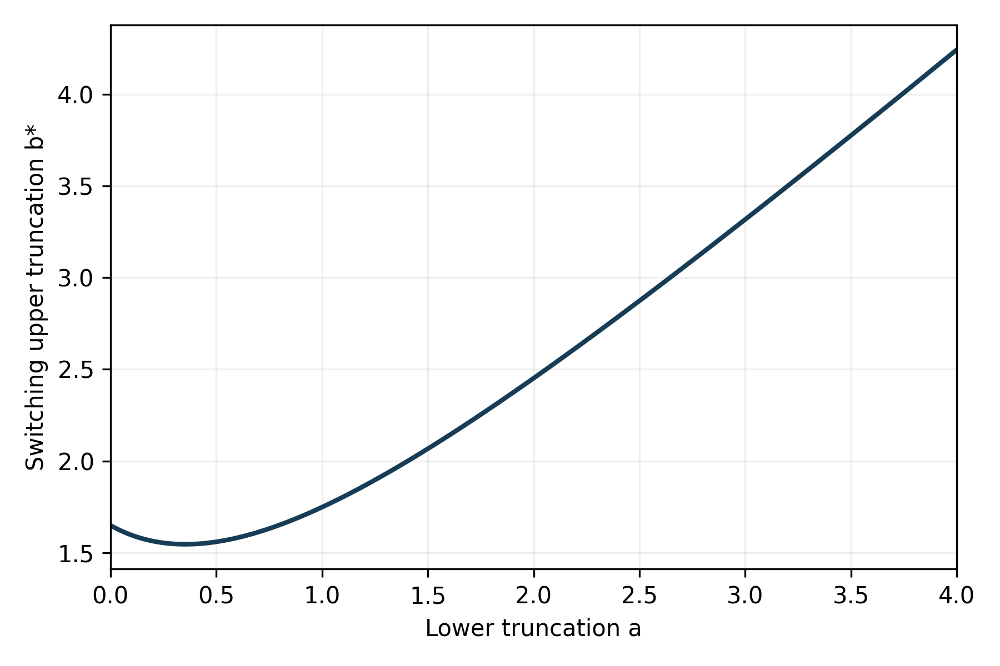
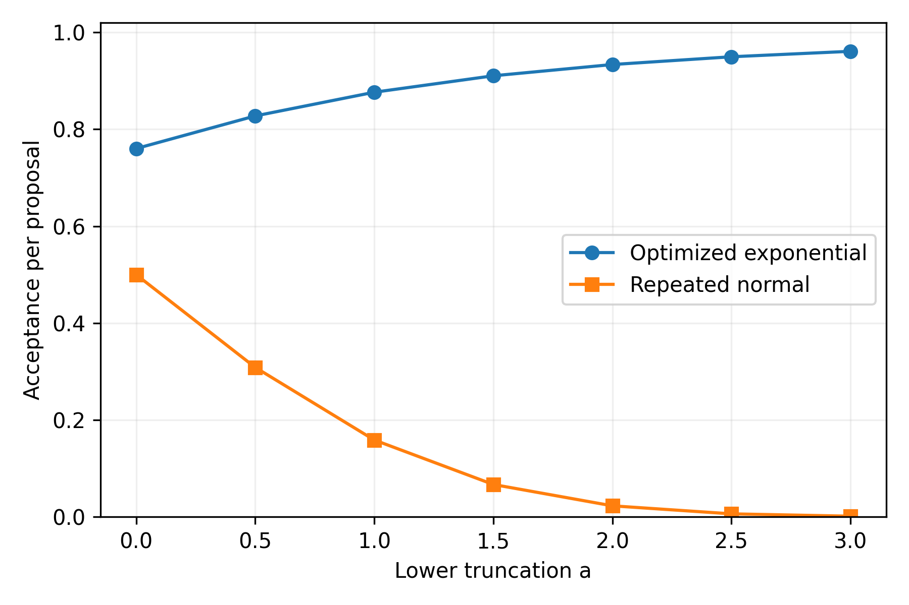

# [Re] Acceptance probabilities in Robert's truncated-normal simulation algorithms

Kyunghan Bae

Independent researcher, South Korea  
Correspondence: qorud001@gmail.com  
12 October 2026

## Abstract

We independently reproduce the univariate numerical results in Robert's study of truncated-normal simulation, using the author's archived reprint. Newly written Python code recalculates seven one-sided and twenty two-sided acceptance probabilities, reconstructs the algorithm-switching figure, and checks the samplers on 23.5 million fixed-seed proposals. Twenty-six of the twenty-seven printed cells agree at their stated three-decimal precision. The one-sided probability at lower truncation point 0.5 is printed as 0.826, while the stated optimized exponential proposal gives 0.8275277271, rounding to 0.828. Independent numerical integration supports the recalculation. All twenty two-sided values are reproduced by selecting between uniform and capped exponential proposals. The reconstructed switching boundary agrees with equality of the acceptance rates. The Monte Carlo experiment reports proposal-level uncertainty and accepted-sample distribution checks for every method-setting pair. The results support the univariate algorithms and identify a localized numerical discrepancy in the archived table. Code, source targets, fixed settings and complete numerical outcomes accompany the replication.

Keywords: truncated normal; accept-reject sampling; computational replication; Monte Carlo; numerical integration

## Original study and numerical target

Robert (1995) develops simulation methods for one-sided and two-sided truncated normal distributions, then uses them as conditional samplers in a multivariate Gibbs construction. Our target is the complete univariate numerical section: Table 2.1, Table 2.2 and Figure 2.1 in the author's arXiv:0907.4010v1 reprint. The author identifies this archive as a reprint of the original version (Robert, 2009).

The reprint has ten manuscript pages and retains a March 1992 date on its final page; the journal article occupies pages 121–125 in volume 5 of Statistics and Computing. We identify the reprint as the exact numerical source, with its URL and SHA-256 in source-provenance.json. Table 2.1 contains seven probabilities for one-sided truncation. Table 2.2 contains twenty probabilities over five lower endpoints and four interval widths. Figure 2.1 plots the choice boundary between two proposals. Section 3 supplies a multivariate construction and a symbolic bivariate example, which are outside this numerical replication.

Botev and L’Ecuyer (2016) provide subsequent numerical comparisons of the same optimized exponential method, including its acceptance probability at a=2 and in more remote tails. Our target is the original reprint’s complete 27-cell numerical audit and switching figure, supplemented by independently implemented sampler diagnostics. Newly written implementations follow the mathematical definitions.

## Algorithms and probability reconstruction

Let φ and Φ be the standard-normal density and distribution function, and write Q=1−Φ. For a lower endpoint a≥0, define

$$\alpha(a)=\frac{a+\sqrt{a^2+4}}2.$$

The optimized exponential proposal draws Z=a+E, where E has rate α. A proposed value is accepted when an independent U uniform on [0,1] satisfies

$$U\leq \exp\left[-\frac{(Z-\alpha)^2}{2}\right].$$

For one-sided truncation [a,∞), the probability per proposal is

$$p_E(a,\infty)=\alpha\exp(\alpha a-\alpha^2/2)\sqrt{2\pi}\,Q(a).$$

For a finite interval [a,b], the same exponential proposal also rejects Z>b, giving

$$p_E(a,b)=\alpha\exp(\alpha a-\alpha^2/2)\sqrt{2\pi}\,[\Phi(b)-\Phi(a)].$$

Here the exponential draw remains supported on [a,∞). Conditioning the proposal itself to lie below b would change the acceptance denominator and would not reproduce the source comparison.

The competing uniform proposal draws Z uniformly on [a,b] and accepts with probability exp[(a²−Z²)/2]. Its average acceptance is

$$p_U(a,b)=\frac{\sqrt{2\pi}\exp(a^2/2)}{b-a}\,[\Phi(b)-\Phi(a)].$$

The recalculated Table 2.2 uses max(p_E,p_U) in every cell. This selects the larger acceptance probability per raw proposal, rather than measuring elapsed runtime. We evaluate normal interval masses as Q(a)−Q(b), using the complementary error function; this avoids subtracting two distribution values near one. Probability products are evaluated through their logarithms.

The source's equation (2.1) gives a switching upper endpoint b*(a). The same boundary has the compact representation

$$b^*(a)=a+\frac{\exp[1/(2\alpha(a)^2)]}{\alpha(a)}.$$

Indeed, equality of the two rates cancels their common normal mass, giving

$$b-a=\frac{\exp[(a-\alpha)^2/2]}{\alpha}.$$

The identity α−a=1/α produces the expression above. This algebraic check supplements a direct implementation of the printed formula.

## Fixed experiment and independent checks

Before calculation, protocol.json recorded the original grids, seed and proposal counts. Table 2.1 uses a=0,0.5,1,1.5,2,2.5,3. Table 2.2 uses a=0,0.5,1,1.5,2 and widths b−a=2,1,0.5,0.1. We recompute Figure 2.1 at 401 equally spaced endpoints from 0 to 4.

We use NumPy's PCG64DXSM generator with base seed 202610120295 and a separate SeedSequence child for each method-setting pair. Each of the seven one-sided cases receives 500,000 exponential proposals. Each of the twenty finite-interval cases receives 500,000 uniform and 500,000 exponential proposals. The resulting 47 pairs contain 23.5 million proposals. Every finite exponential draw beyond its upper endpoint is retained in the proposal denominator and counted as rejected.

For each pair we retain the accepted count, sample first and second moments, support checks and an empirical-distribution distance. Acceptance intervals are pointwise 95% Wilson intervals. Conditional on the number accepted, accepted values form an independent sample from the target distribution. We compare their empirical distribution with the normalized truncated-normal distribution. An additional descriptive Dvoretzky–Kiefer–Wolfowitz diagnostic, absent from the recorded protocol, uses the bound (Massart, 1990)

$$\epsilon_n=\sqrt{\frac{\log(2\times47/0.01)}{2n}}$$

provides a 99% familywise diagnostic across the 47 accepted samples by the union bound, where n is the accepted sample size. Sample-mean z scores and the pointwise acceptance intervals are descriptive diagnostics; all values, including intervals that miss the analytic rate, are retained.

A separate verifier integrates the nonnegative kernel exp[(a²−z²)/2] directly, rather than using the production normal-probability formulas. Integrals of this kernel and its products with z and z² give independent acceptance probabilities and target moments. It checks 45 intervals, including additional lower endpoints 8 and 12, and solves nine switching points numerically from equality of the two integrated rates. It also audits all saved table cells and Monte Carlo summaries. Perturbing α around its optimizer provides an additional check of the stated rate maximization.

## Results

Table 1 reproduces six of the seven one-sided source values at three-decimal precision. The a=0.5 source entry differs by 0.0015277271 from the recalculation. Its value under the displayed algorithm is 0.8275277271 and therefore rounds to 0.828, while the reprint gives 0.826. Direct quadrature agrees with the recalculated probability. This is a localized discrepancy in the identified archived table; comparison with the typeset publisher file and any earlier correction remains a separate source check.

| Lower endpoint a | Source Table 2.1 | Recalculated | Rounded |
|---:|---:|---:|---:|
| 0.0 | 0.760 | 0.7601734505 | 0.760 |
| 0.5 | 0.826 | 0.8275277271 | 0.828 |
| 1.0 | 0.876 | 0.8764686940 | 0.876 |
| 1.5 | 0.910 | 0.9104114061 | 0.910 |
| 2.0 | 0.934 | 0.9336453245 | 0.934 |
| 2.5 | 0.950 | 0.9496703000 | 0.950 |
| 3.0 | 0.961 | 0.9609229843 | 0.961 |

Table 1. Complete comparison with the seven one-sided values in the author's reprint.

Every recalculated two-sided value agrees with the corresponding Table 2.2 entry at three-decimal precision. Table 2 displays the full numerical grid. The suffix U or E identifies the selected uniform or exponential proposal. The complete file also reports the unselected rate, preserving the algorithm comparison behind each printed value.

| Width b−a | a=0 | a=0.5 | a=1 | a=1.5 | a=2 |
|---:|---:|---:|---:|---:|---:|
| 2.0 | 0.725585 E | 0.810873 E | 0.869011 E | 0.907241 E | 0.932346 E |
| 1.0 | 0.855624 U | 0.686606 U | 0.750789 E | 0.825790 E | 0.878247 E |
| 0.5 | 0.959850 U | 0.851446 U | 0.759167 U | 0.680326 U | 0.678806 E |
| 0.1 | 0.998336 U | 0.973809 U | 0.950082 U | 0.927126 U | 0.904913 U |

Table 2. All twenty two-sided probabilities, newly computed to six decimal places.

The original and reduced switching formulas differ by at most 8.9×10⁻¹⁶ over the 401-point grid. At the reconstructed boundary the two acceptance rates differ by at most 2.3×10⁻¹⁵. Numerical root calculations independently confirm the equality.

The fixed-seed simulation produces accepted values inside their intended support in all 47 pairs. All accepted-sample empirical distribution distances satisfy the familywise 99% diagnostic bound. Forty-four of the 47 pointwise 95% Wilson intervals contain the analytic rate. The largest absolute acceptance z score is 2.1002 and the largest absolute accepted-sample mean z score is 1.876. These summaries support the implemented probabilities and sample distributions while preserving the expected variation of pointwise intervals.

At a=0.5, the exponential sampler accepts 414,025 of 500,000 proposals, giving 0.828050 with a 95% Wilson interval [0.827002,0.829093]. This provides a stochastic check alongside the deterministic formula and independent integral.

The qualitative one-sided conclusion is reproduced: acceptance rises from approximately 0.760 at a=0 to 0.961 at a=3, whereas repeated standard-normal sampling accepts only Q(a). Uniform proposals are preferable for sufficiently narrow finite intervals, as reflected in the source's switching boundary and Table 2.2.

## Interpretation and reproducibility

The study reproduces the entire numerical univariate section and identifies one printed probability requiring correction under the source's stated algorithm. It supports the optimized exponential and uniform accept-reject constructions. The numerical evidence concerns acceptance and output distributions; algorithm speed depends on generator and implementation costs and was not inferred from these rates.

The generated samples use precisely specified normal targets. The replication contribution is the complete original-table comparison, independent integration checks and reproducible sampler diagnostics for the identified source version, alongside the subsequent algorithm comparisons of Botev and L’Ecuyer (2016).

A fresh Python 3.12 environment with requirements.txt runs replicate.py followed by verify.py. The package includes the original numerical anchors, fixed protocol, all 27 comparisons, 401 boundary checkpoints, every method-setting result, source retrieval hash, independent verification and newly generated figures. Large accepted-sample arrays are reproducible from the saved generator seeds; the recorded CSVs retain counts and moment summaries. Runtime and installed versions are recorded in summary.json. The recorded 116.24 seconds cover the numerical experiment and CSV/JSON generation, before figure rendering, on Windows 11 with Python 3.12.9. NumPy 2.3.5, SciPy 1.15.3 and Matplotlib 3.10.8 are pinned. This elapsed time is a reproducibility detail rather than a comparison of sampler runtimes. The source PDF is linked rather than redistributed.

## Declarations

The author initiated the project and approved submission. OpenAI Codex agents assisted with source examination, experimental design, code implementation, execution, mathematical and numerical checks, figure generation and manuscript drafting. Exact model versions across the full agent workflow were not recorded.

The research received no external funding. The author declares no competing interests. The study uses simulated random variables and involves no human participants or personal records.

New code is distributed under the MIT License; the manuscript, generated figures and results are distributed under CC BY 4.0.

## References

Robert, C. P. (1995). Simulation of truncated normal variables. Statistics and Computing, 5, 121–125. https://doi.org/10.1007/BF00143942 . Author's reprint: https://arxiv.org/abs/0907.4010v1 .

Robert, C. P. (2009). Simulation of truncated normal variables [reprint]. Xi'an's Og, 24 July. https://xianblog.wordpress.com/2009/07/24/simulation-of-truncated-normal-variables-reprint/ .

Massart, P. (1990). The tight constant in the Dvoretzky–Kiefer–Wolfowitz inequality. The Annals of Probability, 18(3), 1269–1283. https://doi.org/10.1214/aop/1176990746 .

Botev, Z. I., and L’Ecuyer, P. (2016). Simulation from the normal distribution truncated to an interval in the tail. Les Cahiers du GERAD, G-2016-62. https://www.gerad.ca/en/papers/G-2016-62 .
